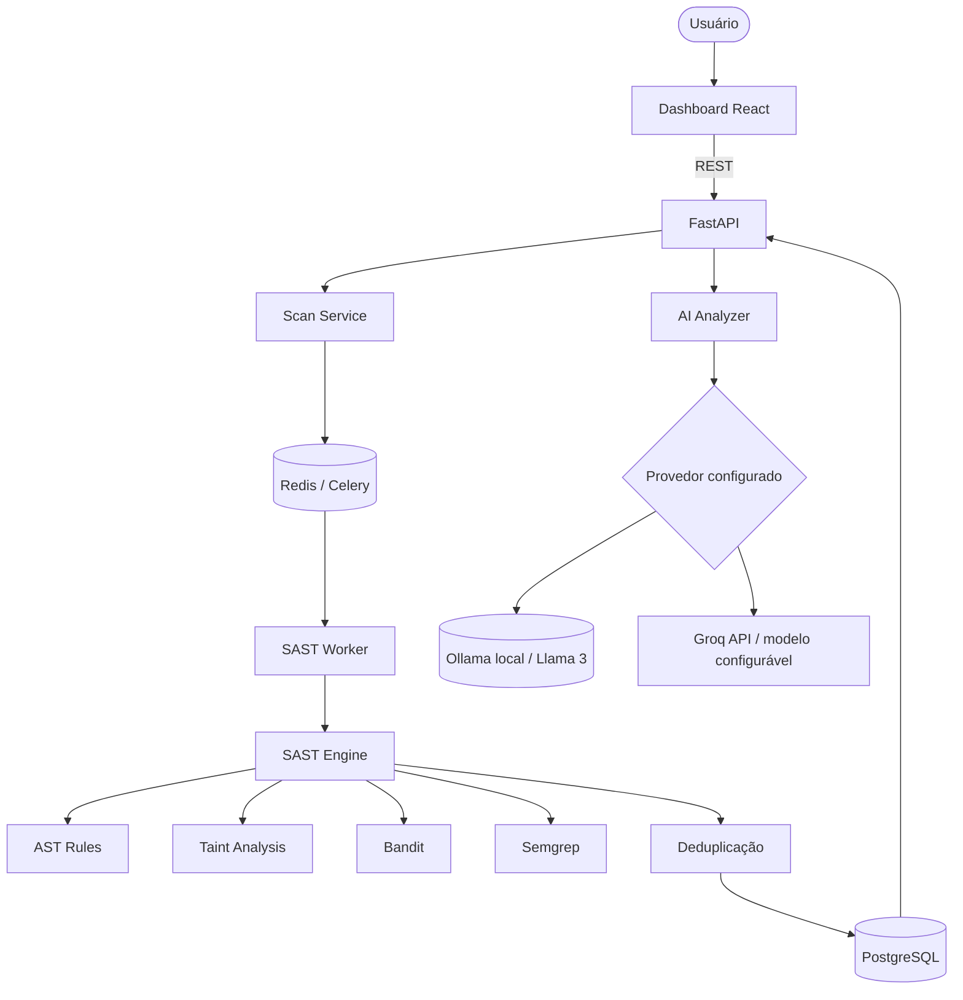

# 🛡️ SASTGuard

O **SASTGuard** é uma plataforma completa de SAST (Static Application Security
Testing) e DevSecOps que analisa código-fonte Python **sem executá-lo**, detecta
vulnerabilidades, realiza análise de fluxo de dados (taint analysis), pode enriquecer
os findings com uma LLM local (Ollama) ou por API (Groq) e integra os resultados
a um security gate de CI/CD.

> Projeto Integrador da FIAP. Desenvolvido com FastAPI, um motor próprio de
> AST + taint, Bandit, Semgrep, Ollama (IA local opcional), Groq (API),
> PostgreSQL, Redis/Celery, React e Docker. A demonstração online utiliza
> serviços com planos gratuitos, sujeitos a limites e disponibilidade.

---

## Sumário

1. [O que faz](#o-que-faz)
2. [Arquitetura](#arquitetura)
3. [Tecnologias](#tecnologias)
4. [Estrutura do projeto](#estrutura-do-projeto)
5. [Instalação](#instalação)
6. [Execução com Docker](#execução-com-docker)
7. [Desenvolvimento local (sem Docker)](#desenvolvimento-local-sem-docker)
8. [IA: Ollama local ou Groq por API](#ia-ollama-local-ou-groq-por-api)
9. [Executando análises](#executando-análises)
10. [API](#api)
11. [Regras de detecção](#regras-de-detecção)
12. [Taint Analysis](#taint-analysis)
13. [Módulo de IA](#módulo-de-ia)
14. [Security Gate](#security-gate)
15. [Pipeline CI/CD](#pipeline-cicd)
16. [Testes](#testes)
17. [Relatórios](#relatórios)
18. [Limitações](#limitações)
19. [Ética](#ética)
20. [Demonstração online](#demonstração-online)

---

## O que faz

- Faz o parse de Python com o módulo padrão `ast` (nunca executa o código analisado).
- Detecta mais de 16 classes de vulnerabilidade com regras **baseadas em AST e
  conscientes do contexto**.
- Executa **taint analysis intraprocedural** (`SOURCE → PROPAGATION → SINK`) com
  reconhecimento de sanitizers e detecção de queries parametrizadas.
- Combina três engines — o motor próprio, o **Bandit** e o **Semgrep** — e
  **deduplica** os findings, registrando quais engines sinalizaram cada um.
- Pode enriquecer os findings com uma LLM via **Ollama local** ou **Groq API**
  (severity, probabilidade de falso positivo, impacto, remediação, código
  corrigido), com fallback para a análise determinística.
- Expõe uma API REST em **FastAPI** e um dashboard em **React** que consome a API real.
- Aplica um **Security Gate** configurável e inclui uma **CLI** para CI/CD.
- Exporta relatórios em **JSON**, **HTML** e **SARIF 2.1.0**.

---

## Arquitetura



O modelo C4 detalhado está em [docs/ARCHITECTURE.md](docs/ARCHITECTURE.md).

**Observação sobre a implantação:** o diagrama acima representa a arquitetura
completa, incluindo a opção de processamento assíncrono com Redis/Celery. Na
versão online atualmente demonstrada, frontend e API estão hospedados
separadamente e a análise funciona sem worker Redis/Celery hospedado. Não se
deve confundir essa implantação com a stack completa do Docker Compose.

---

## Tecnologias

| Camada       | Tecnologia |
|--------------|------------|
| API          | FastAPI, Uvicorn, Pydantic v2 |
| SAST engine  | `ast` do Python, regras próprias, taint analysis própria, Bandit, Semgrep |
| Persistência | SQLAlchemy 2.0, PostgreSQL (SQLite para dev local) |
| Processamento assíncrono | Celery + Redis |
| IA           | Ollama (Llama 3) local ou Groq API (modelo configurável) |
| Frontend     | React 18, TypeScript, Vite, Recharts |
| DevSecOps    | Docker, Docker Compose, GitHub Actions |
| Testes       | pytest |

---

## Estrutura do projeto

```
backend/
  app/
    api/            routers REST (health, scans, findings, dashboard, gate)
    core/           config, database, enums
    models/         models SQLAlchemy (Scan, Finding, AIAnalysis, GateResult)
    schemas/        schemas Pydantic
    services/       scan, security gate, upload, reports, dashboard
    repositories/   acesso a dados
    workers/        app Celery + tasks
    cli.py          interface de linha de comando para CI/CD
    main.py         aplicação FastAPI
  sast/
    parser/         parser AST + helpers
    rules/          regras AST extensíveis
    taint/          motor de taint analysis
    scanners/       wrappers AST / Bandit / Semgrep
    engine.py       orquestração + deduplicação
  ai/               ollama_client, groq_client, analyzer, prompts
  tests/            suíte pytest
frontend/           dashboard React + TypeScript + Vite
vulnerable_samples/ código Python propositalmente vulnerável + seguro
semgrep_rules/      regras Semgrep próprias
docs/               arquitetura, engine, taint, IA, devsecops, demo
.github/workflows/  security.yml
docker-compose.yml
```

---

## Instalação

Requisitos:

- **Python 3.11+** (funciona em 3.10; a imagem Docker usa 3.11).
- **Node 18+** para fazer o build/executar o frontend.
- **Docker + Docker Compose** (recomendado) para subir toda a stack.
- **Ollama** (opcional) para o enriquecimento com IA.

Clone o projeto e copie o template de variáveis de ambiente:

```bash
cp .env.example .env
```

---

## Execução com Docker

A stack completa (frontend, backend, worker, PostgreSQL, Redis, Ollama):

```bash
docker compose up --build
```

- Dashboard: http://localhost:3000
- API + docs: http://localhost:8000/docs
- Health: http://localhost:8000/health

Baixe um modelo para a análise com IA (apenas na primeira vez):

```bash
docker compose exec ollama ollama pull llama3
```

> Se o Docker não estiver instalado, veja a próxima seção para executar localmente.

---

## Desenvolvimento local (sem Docker)

Usa-se um ambiente virtual Python para não alterar o ambiente da máquina.

```bash
# a partir da raiz do projeto
python -m venv .venv
.venv\Scripts\activate            # Windows
# source .venv/bin/activate       # Linux/macOS

pip install -r backend/requirements.txt
```

Execute a API (usa um banco SQLite local por padrão, sem necessidade de Postgres):

```bash
cd backend
uvicorn app.main:app --reload
```

A análise é executada de forma **síncrona** quando o Redis não está disponível,
então a API funciona mesmo sem um broker. Para rodar o worker assíncrono:

```bash
celery -A app.workers.celery_app.celery_app worker --loglevel=info
```

Frontend (requer Node 18+):

```bash
cd frontend
npm install
npm run dev        # http://localhost:5173, faz proxy de /api para a porta 8000
```

Scanners externos opcionais (o Bandit já está nos requirements; o Semgrep é pesado):

```bash
pip install -r backend/requirements-sast.txt
```

---

## IA: Ollama local ou Groq por API

O SASTGuard aceita dois provedores de IA. **Ollama** permite executar um
modelo localmente; **Groq** permite utilizar um modelo remoto via API. A IA
complementa a análise SAST, mas não substitui o motor determinístico.

### Ollama local

```bash
# instale a partir de https://ollama.com, depois:
ollama pull llama3
ollama serve
```

Configure no `.env`:

```
OLLAMA_ENABLED=true
OLLAMA_BASE_URL=http://localhost:11434
OLLAMA_MODEL=llama3
AI_PROVIDER=ollama
```

### Groq API (implantação online)

Crie uma chave em https://console.groq.com/keys e configure as variáveis
**privadamente** no ambiente do backend (por exemplo, Render):

```dotenv
AI_PROVIDER=groq
OLLAMA_ENABLED=false
GROQ_API_KEY=<defina-a-chave-no-provedor-de-hospedagem>
GROQ_MODEL=openai/gpt-oss-120b
GROQ_TIMEOUT=60
```

O modelo `openai/gpt-oss-120b` foi utilizado no teste online de outubro de
2026; sua disponibilidade e os limites gratuitos podem mudar. Não inclua
chaves reais no repositório, em capturas de tela ou em logs. Chaves expostas
devem ser revogadas e substituídas.

Se o provedor configurado estiver indisponível, a plataforma continua
funcionando e retorna `"AI analysis unavailable"`, preservando a análise
determinística. O uso de uma API externa implica o envio de contexto mínimo
do finding ao provedor: não envie segredos ou código confidencial sem autorização.

---

## Executando análises

**Pelo dashboard:** Nova Análise → escolha um caminho local (ex.:
`/app/vulnerable_samples`) ou envie um `.py`/`.zip` → Iniciar Análise.

**Pela CLI** (ideal para CI):

```bash
cd backend
python -m app.cli scan ../vulnerable_samples --gate \
  --json ../sast-report.json --html ../sast-report.html --sarif ../sast-report.sarif
```

Códigos de saída: `0` = PASS, `1` = Security Gate FAIL, `2` = erro da ferramenta.

---

## API

| Método | Rota | Descrição |
|--------|------|-----------|
| GET  | `/health` | Health do serviço |
| POST | `/api/scans` | Cria uma análise para um caminho no servidor |
| POST | `/api/scans/upload` | Cria uma análise a partir de um arquivo/zip enviado |
| GET  | `/api/scans` | Lista as análises |
| GET  | `/api/scans/{id}` | Detalhe da análise com os findings |
| GET  | `/api/scans/{id}/findings` | Findings (filtros: severity, file, cwe, engine) |
| GET  | `/api/findings/{id}` | Detalhe do finding |
| POST | `/api/findings/{id}/ai-analysis` | Executa a análise com IA para um finding |
| GET  | `/api/dashboard/summary` | Totais por severity |
| GET  | `/api/dashboard/severity` | Distribuição por severity |
| GET  | `/api/dashboard/trends` | Evolução por análise |
| GET  | `/api/dashboard/critical-files` | Arquivos mais críticos |
| POST | `/api/security-gate/evaluate` | Avalia o gate para uma análise |

Documentação interativa em `/docs`.

### Upload seguro

Os uploads são validados contra: allow-list de extensões (`.py`, `.zip`),
tamanho máximo, **path traversal**, **Zip Slip**, número excessivo de membros e
tamanho descomprimido (mitigação de zip bomb). O código enviado **nunca é
executado**.

---

## Regras de detecção

Veja [docs/SAST_ENGINE.md](docs/SAST_ENGINE.md). As classes cobertas incluem:
senha hardcoded, API key/token hardcoded, `eval`, `exec`,
`subprocess(shell=True)`, `os.system`, SQL injection, command injection,
`pickle` inseguro, `yaml.load` inseguro, MD5, SHA1, `random` inseguro em contexto
de segurança, `requests(verify=False)`, Flask `debug=True` e path traversal.

As regras são **extensíveis**: basta criar uma subclasse de `Rule` com
`@register` e ela passa a integrar o engine automaticamente.

---

## Taint Analysis

Veja [docs/TAINT_ANALYSIS.md](docs/TAINT_ANALYSIS.md). Rastreia dados não
confiáveis desde as sources (`input`, `request.args`, `os.environ`, …), passando
pela propagação entre variáveis, até os sinks perigosos (`cursor.execute`,
`os.system`, `eval`, `open`, …), e reporta o fluxo completo
`SOURCE → PROPAGATION → SINK`. Sanitizers (`int`, `shlex.quote`,
`os.path.basename`, …) e queries parametrizadas removem o taint.

---

## Módulo de IA

A integração com Groq foi validada online em um finding de SQL Injection,
com classificação, confiança, explicação, impacto, remediação e exemplo de
código corrigido. O modelo local via Ollama permanece como opção, mas seu
funcionamento não foi validado na implantação online.

Veja [docs/AI_MODULE.md](docs/AI_MODULE.md). A IA é uma **segunda opinião**, nunca
o detector principal. Para um finding, ela retorna JSON estruturado: `severity`,
`confidence`, `possible_false_positive`, `explanation`, `impact`, `remediation`,
`fixed_code`. Tanto `original_severity` quanto `ai_severity` são preservados.

---

## Security Gate

Política padrão:

- **FAIL** quando `≥ 1 CRITICAL` **ou** `≥ 3 HIGH`
- **WARNING** quando a contagem de `MEDIUM` atinge o limite configurado (padrão 5)
- **PASS** caso contrário

A política é configurável via payload da API ou flags da CLI
(`--fail-critical`, `--fail-high`, `--warn-medium`).

---

## Pipeline CI/CD

O `.github/workflows/security.yml` executa: checkout → setup do Python → instalar
dependências → testes → análise do SASTGuard → gerar relatórios → Security Gate.
Os relatórios (`sast-report.json/html/sarif`) são enviados como artifacts.
O workflow também **tenta** enviar o SARIF para o code scanning do GitHub;
essa publicação depende das permissões e recursos disponíveis no repositório.

**Demonstração do bloqueio:** o pipeline atual analisa `vulnerable_samples/`,
com código intencionalmente inseguro. Em 13/10/2026, identificou 36 findings
(6 CRITICAL, 17 HIGH, 8 MEDIUM e 5 LOW) e o Security Gate retornou FAIL.
Após o ajuste do workflow, a execução foi corretamente marcada como **Failure**.
Esse vermelho é esperado no cenário de demonstração, mas não deve ser tratado
como um pipeline de produção saudável. Ainda é recomendável separar uma
análise de código seguro, que deve passar, do cenário vulnerável, que deve
falhar. Veja [docs/DEVSECOPS.md](docs/DEVSECOPS.md).

---

## Testes

```bash
cd backend
pytest
```

A suíte valida **detecção real** (não apenas que uma função foi chamada): parser,
cada regra (casos positivos + negativos), taint source/propagation/sink,
sanitizers, deduplicação, o security gate e os endpoints da API.

---

## Relatórios

- **JSON** — resumo + findings legível por máquina.
- **HTML** — relatório autocontido com tema escuro, cards de severity, tabela de
  findings e os taint paths.
- **SARIF 2.1.0** — para o code scanning do GitHub e outros consumidores SARIF.

---

## Limitações

- A taint analysis é majoritariamente **intraprocedural**, com um seed
  interprocedural limitado (argumentos contaminados propagam para funções
  chamadas). Ela não modela grafos de chamada completos, aliasing ou fluxos
  específicos de frameworks.
- O motor próprio cobre apenas **Python**.
- A detecção de segredos usa heurísticas de valor/nome e pode não cobrir formatos
  de token customizados.
- A qualidade da saída da IA depende do modelo e do provedor; ela é consultiva,
  não autoritativa. O uso da Groq API depende de conectividade, cotas e
  disponibilidade do serviço.
- O Semgrep é pesado; ele roda dentro do Docker/CI e é opcional localmente.
- A implantação online gratuita pode apresentar demora no primeiro acesso
  após inatividade e não executa toda a stack assíncrona do Docker Compose.
- O pipeline de demonstração verifica amostras vulneráveis intencionalmente;
  seu FAIL não indica necessariamente uma vulnerabilidade no próprio backend.

---

## Ética

O SASTGuard é uma ferramenta **defensiva**. O diretório `vulnerable_samples/`
contém código propositalmente inseguro, usado **apenas** como alvo de análise e
para demonstração; a plataforma nunca executa o código analisado. Utilize a
ferramenta para encontrar e corrigir vulnerabilidades em software que você esteja
autorizado a testar. Não a utilize para atacar sistemas que você não possui ou
não tem permissão para avaliar. Segredos commitados no código devem ser rotacionados
imediatamente após serem detectados.

---

## Demonstração online

- **Frontend:** https://sast-guard.vercel.app
- **API:** https://sastguard-api.onrender.com
- **Swagger/OpenAPI:** https://sastguard-api.onrender.com/docs
- **Código e pipeline:** https://github.com/LorenzzoDiass/SASTGuard

Na implantação de demonstração, o frontend React/Vite é servido pela Vercel,
a API FastAPI pelo Render e os dados são persistidos em PostgreSQL. A
integração com Groq permite a análise complementar por IA sob demanda.
A hospedagem utiliza camadas gratuitas sujeitas a suspensão por inatividade,
cotas e mudanças de disponibilidade.

### Roteiro de demonstração

1. Abrir o dashboard e apresentar os totais por severidade.
2. Executar uma análise de um projeto Python de teste autorizado.
3. Abrir um finding de SQL Injection e mostrar SOURCE → PROPAGATION → SINK.
4. Clicar em **Analisar com IA** e mostrar a explicação e o código sugerido.
5. Avaliar o Security Gate e mostrar o resultado FAIL para o código vulnerável.
6. Abrir o GitHub Actions e mostrar o bloqueio automático do pipeline.
7. Baixar o artifact `sast-reports` e abrir `sast-report.html`; os formatos
   JSON e SARIF também estão incluídos.

Antes de uma apresentação ao vivo, acessar a API para acordar a instância
gratuita do Render e testar a integração com IA.
