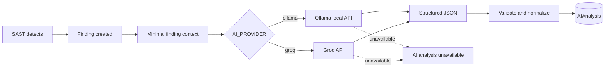
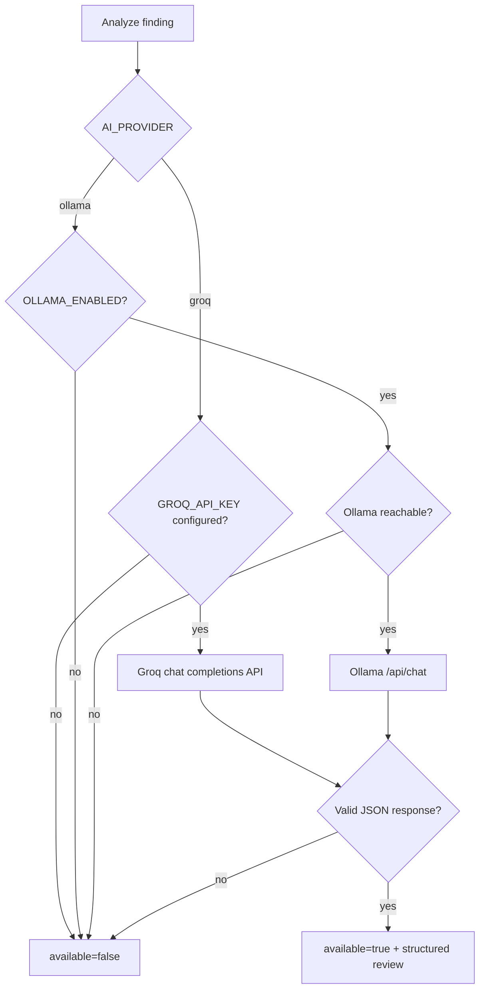

# AI Module

The AI module is a **second-opinion layer**. It does not perform primary vulnerability detection: the deterministic SAST engine creates the finding first. The LLM then reviews the finding and provides structured guidance.

The project supports two AI providers:

- **Ollama (local)**: intended for local or Docker-based deployments, with a locally available model such as `llama3`.
- **Groq API (remote)**: used by the online demonstration deployment, with the model `openai/gpt-oss-120b` successfully tested in the SASTGuard interface.



## Contract

The model is instructed to return a JSON object with these fields:

```json
{
  "severity": "HIGH",
  "confidence": 0.90,
  "possible_false_positive": false,
  "explanation": "...",
  "impact": "...",
  "remediation": "...",
  "fixed_code": "..."
}
```

The analyzer (`backend/ai/analyzer.py`) normalizes the response:

- `severity` is converted to uppercase and validated against supported severity values.
- `confidence` is converted to a number and clamped to the range `0..1`.
- `possible_false_positive` accepts boolean values or string equivalents.
- JSON parsing tolerates code fences or surrounding text.
- If the provider is unavailable or the response cannot be parsed, the result is marked `available=false`.

The `confidence` field is the **model's own estimate**, not an independently calibrated probability.

## Severity preservation

The platform retains the deterministic engine's original assessment alongside the AI suggestion:

- `original_severity`: the severity assigned by the deterministic SAST engine.
- `ai_severity`: the optional severity suggested by the LLM.

The original assessment remains available for audit and comparison. AI output is advisory and should be reviewed rather than treated as definitive.

## Provider selection and graceful fallback



- `backend/ai/ollama_client.py` checks Ollama availability through `GET /api/tags` and calls `POST /api/chat`.
- `backend/ai/groq_client.py` calls Groq's OpenAI-compatible `POST /openai/v1/chat/completions` endpoint and requests a JSON object.
- `backend/ai/analyzer.py` selects the provider based on `AI_PROVIDER`.
- A provider error does **not** prevent deterministic scanning, findings retrieval, or Security Gate evaluation.

## Configuration

Example for the **online Render deployment** (configure these in the service's private Environment settings):

```dotenv
AI_PROVIDER=groq
OLLAMA_ENABLED=false
GROQ_MODEL=openai/gpt-oss-120b
GROQ_API_KEY=<set privately in Render; never commit a real key>
```

Example for **local Ollama**:

```dotenv
AI_PROVIDER=ollama
OLLAMA_ENABLED=true
OLLAMA_BASE_URL=http://localhost:11434
OLLAMA_MODEL=llama3
```

The Groq free tier may have request limits and can change; it should not be described as an unlimited or guaranteed service. **Never put API keys in source files, commits, screenshots, or public documentation.** Revoke and replace any exposed key.

## Running it

- **On demand, per finding:** `POST /api/findings/{id}/ai-analysis` (used by the **Analisar com IA** button).
- **During a scan:** the application supports a `run_ai=true` option for enrichment of selected higher-severity findings, subject to the scan endpoint's supported request parameters.

## Online validation

During the October 2026 demonstration preparation, the hosted frontend and backend successfully returned an AI-generated review for a SQL Injection finding, including severity, confidence, false-positive assessment, explanation, impact, remediation, and suggested corrected code.

This confirms the **Groq-backed on-demand analysis** path. It does not by itself establish that every provider, model, automatic enrichment path, or deployment configuration has been tested.

## Limitations

- LLM responses can be incomplete, inaccurate, or inconsistent; developers must verify suggested fixes.
- The LLM is a secondary reviewer, not the detection engine or the final authority for Security Gate decisions.
- Remote API use transmits selected finding context to a third-party service. Do not send confidential source code, credentials, or sensitive project information without authorization.
- API availability, rate limits, and model access can affect enrichment; deterministic scanning continues independently.
