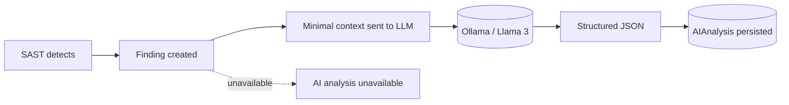
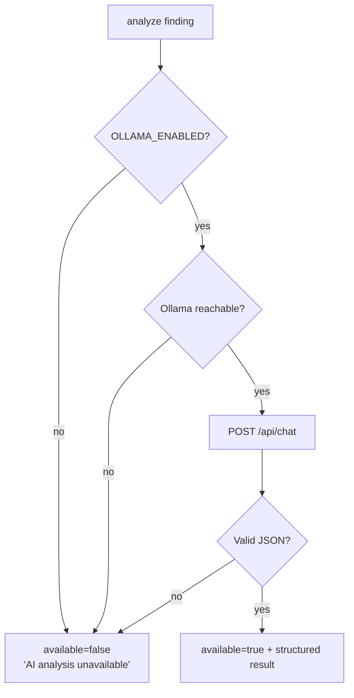

# AI Module

The AI module is a **second-opinion layer**. It never performs primary detection —
the deterministic engine does that. The LLM only reviews an already-detected
finding and returns structured guidance.



## Contract

For a finding, the model must return JSON with exactly these keys:

```json
{
  "severity": "HIGH",
  "confidence": 0.90,
  "possible_false_positive": false,
  "explanation": "...",
  "impact": "...",
  "remediation": "...",
  "fixed_code": "..."
}
```

The analyzer (`ai/analyzer.py`) validates and normalizes the response:

- `severity` is upper-cased and checked against the allowed set (else dropped).
- `confidence` is coerced into `0..1`.
- `possible_false_positive` accepts booleans or `"true"/"false"` strings.
- JSON is extracted robustly even if the model wraps it in prose or code fences.

## Severity preservation

Both values are kept so reviewers can compare:

- `original_severity` — the deterministic engine's severity (immutable).
- `ai_severity` — the model's suggestion (nullable).

The finding's displayed severity is updated to the AI value when available, but
the original is never lost.

## Graceful fallback



The client (`ai/ollama_client.py`) checks availability via `GET /api/tags` and
calls `POST /api/chat` with `format: json` and low temperature. Any failure
returns `None`, so the platform **never breaks** when the model is down — it falls
back to the deterministic analysis and reports `"AI analysis unavailable"`.

## Running it

- Per finding, on demand: `POST /api/findings/{id}/ai-analysis`.
- During a scan: pass `run_ai=true` (enriches CRITICAL/HIGH findings to keep
  runtime bounded).

No paid or remote APIs are used — only a local Ollama server.
