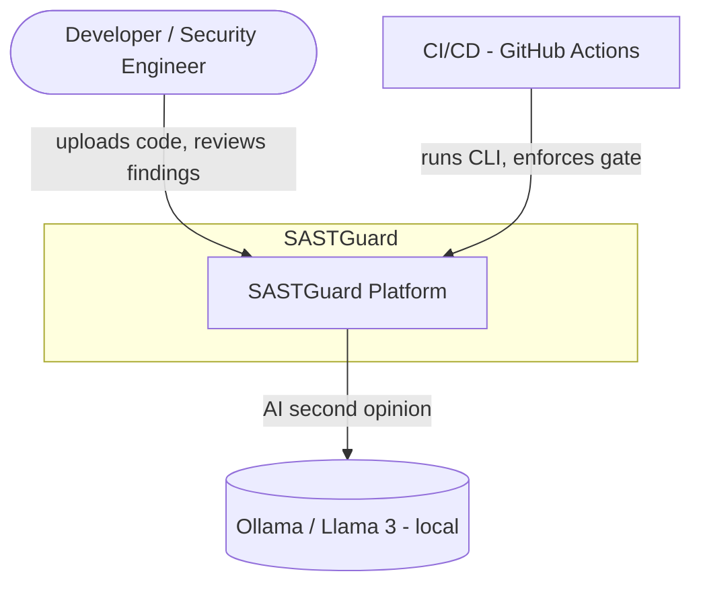
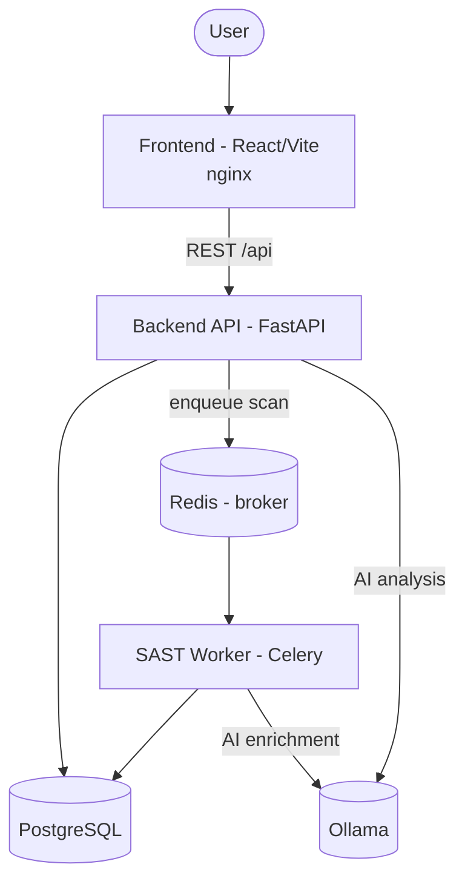
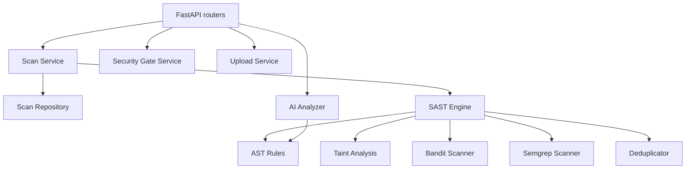
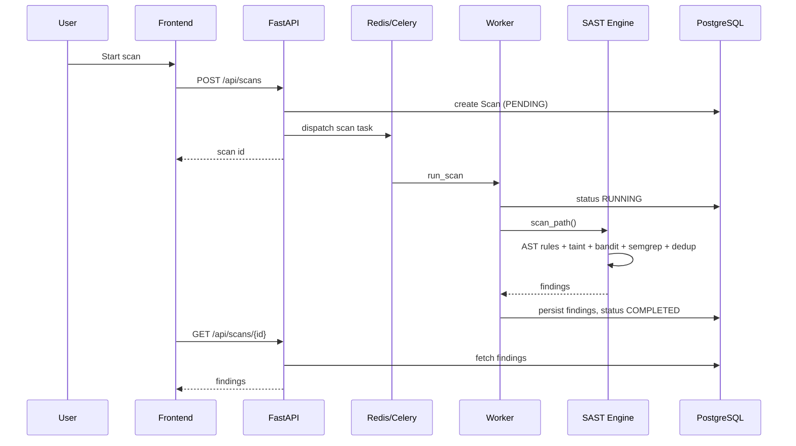
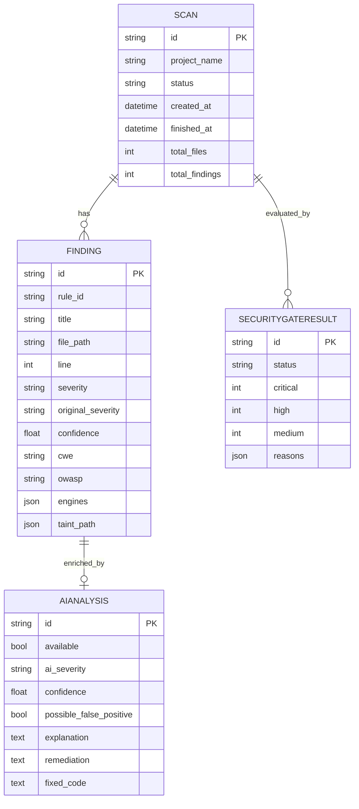

# Architecture

SASTGuard separates concerns into clear layers: the **API**, the **SAST engine**,
the **AI analyzer**, **persistence**, and **async processing**. The SAST engine is
fully decoupled from the web/DB layers so it can run standalone from the CLI.

## C4 — Context (Level 1)

## C4 — Containers (Level 2)

## C4 — Components (Level 3, backend)

## Scan sequence

> When a Celery broker is unavailable (e.g. local dev without Redis), the API
> runs the scan synchronously so the workflow still completes.

## Data model

## Design principles

- **Determinism first.** The AST + taint engine is the source of truth; the LLM
  only annotates.
- **Fail open for availability.** Missing Redis or Ollama degrades gracefully
  instead of breaking the platform.
- **Never execute analysed code.** All analysis is static over the AST.
- **Normalize + deduplicate.** All engines produce the same `Finding` shape and
  overlapping results merge, recording every engine that reported them.
