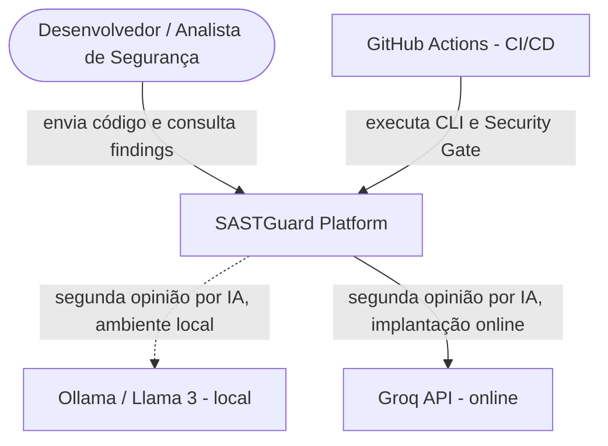
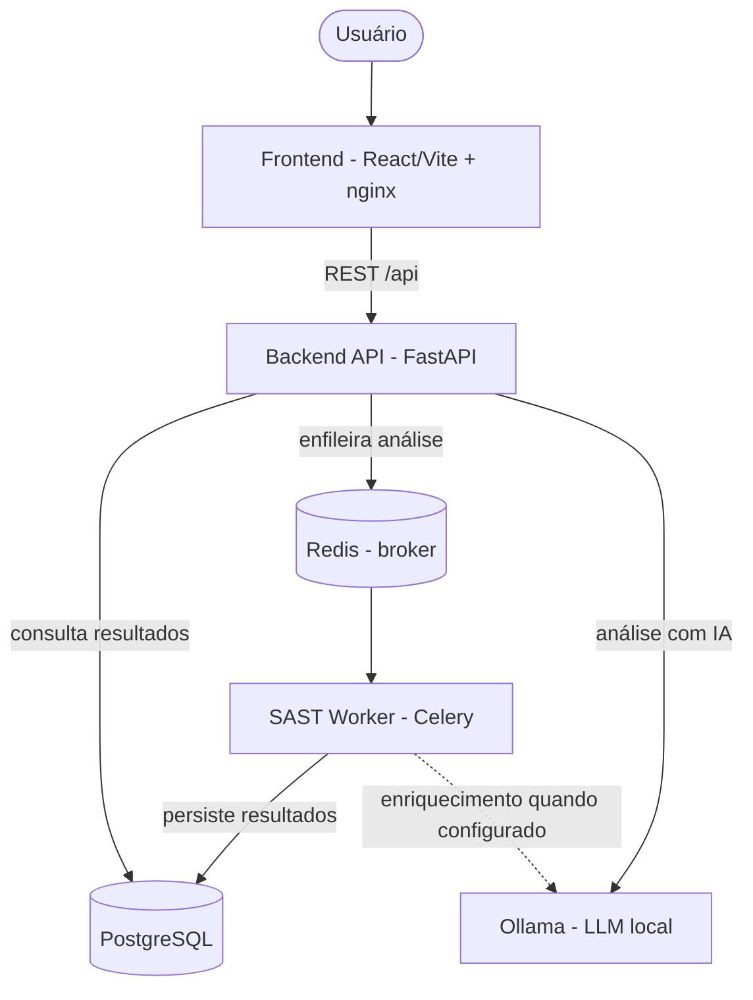
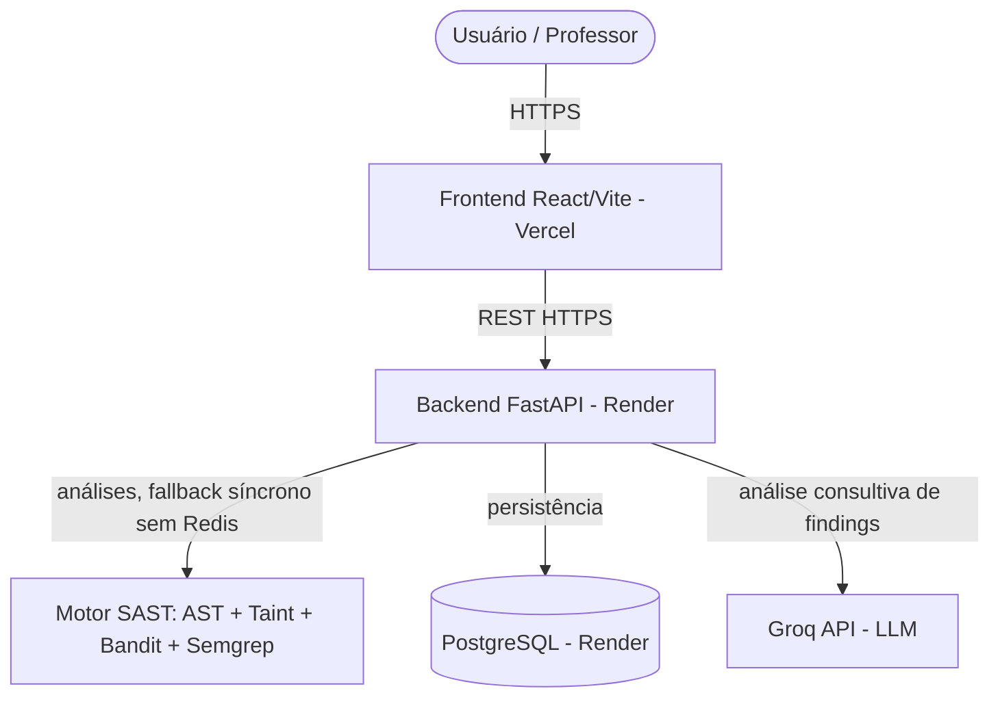
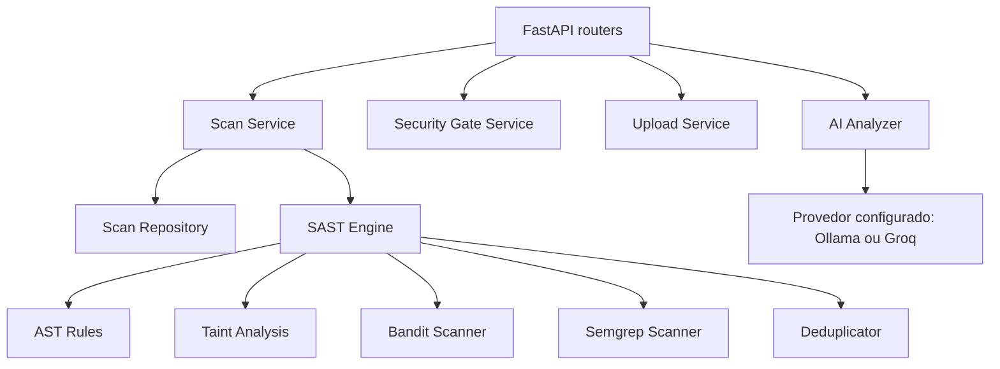
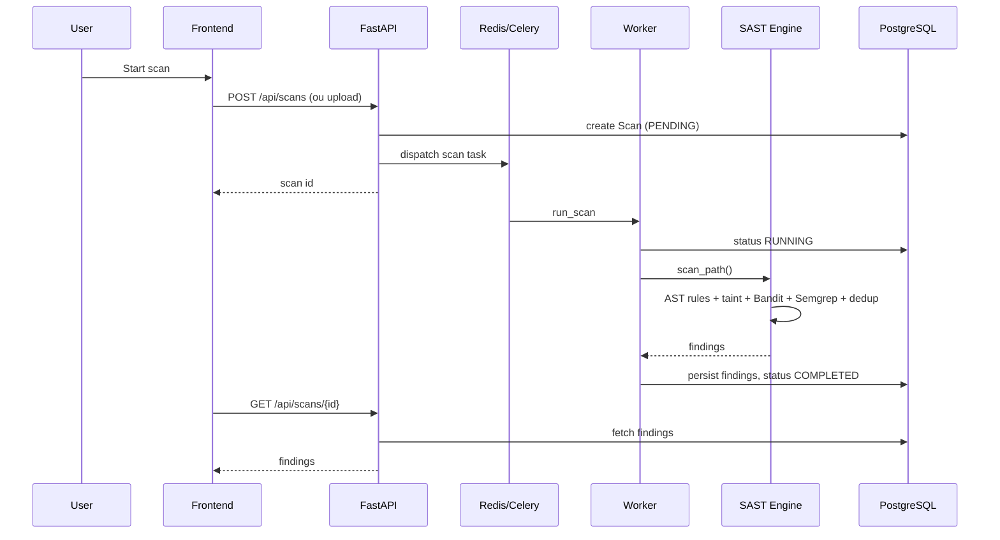
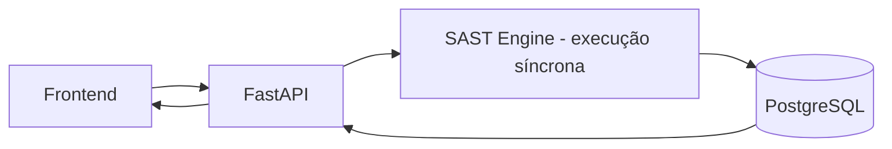
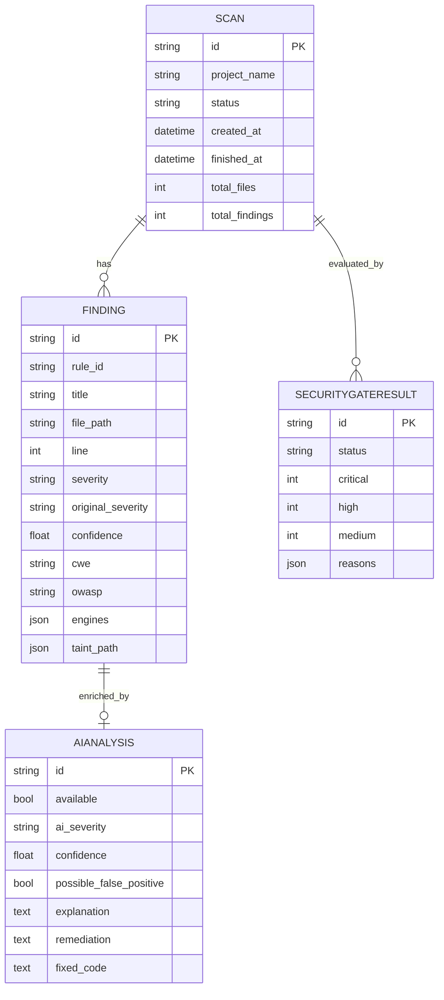

# Architecture — SASTGuard

O SASTGuard separa responsabilidades entre **API**, **motor SAST**, **analisador de IA**, **persistência** e **processamento de análises**. O motor SAST não depende da interface web nem do banco de dados e também pode ser executado pela CLI.

> **Duas formas de execução:** a arquitetura completa de desenvolvimento usa Docker Compose, Redis/Celery e Ollama; a implantação online de demonstração utiliza Vercel (frontend), Render (API e PostgreSQL), execução síncrona quando não há broker Redis e Groq como provedor de LLM. Não há evidência de Redis/Celery ou Ollama hospedados na implantação online.

## C4 — Context (Level 1)

O serviço de IA é **consultivo**: a detecção e a severidade original do motor determinístico são preservadas. A indisponibilidade da IA não impede a análise SAST.

## C4 — Containers (Level 2, Docker Compose)

Este diagrama representa a **arquitetura containerizada do projeto**, não a infraestrutura que está rodando no Render.

## Implantação online de demonstração

- Frontend: <https://sast-guard.vercel.app>
- API: <https://sastguard-api.onrender.com>
- A API online e o banco PostgreSQL foram testados com análises reais; a análise de IA por Groq também foi testada.
- **Redis/Celery e Ollama não foram implantados na nuvem** nesta configuração. O sistema usa o caminho de execução sem broker disponível, descrito abaixo.
- O plano gratuito do Render pode suspender a API por inatividade, causando demora na primeira requisição. Antes da apresentação, abrir o sistema e aguardar a API responder.
- A chave da Groq deve ficar apenas em variáveis de ambiente privadas do Render, nunca no repositório ou em capturas de tela. Chaves expostas devem ser revogadas e substituídas.

## C4 — Components (Level 3, backend)

## Scan sequence — processamento com Celery

### Caminho alternativo — sem Redis/Celery disponível

Quando o broker Celery não está disponível, o serviço de análise tem um **fallback síncrono**. A API aciona o motor SAST diretamente, persiste os resultados e permite consultá-los pelo frontend. Esse caminho foi validado na implantação online com uma análise concluída. A duração da requisição e a ordem exata das atualizações de status dependem da implementação do serviço.

## Data model

## CI/CD e Security Gate

O workflow `.github/workflows/security.yml` executa testes, analisa o diretório `vulnerable_samples`, gera relatórios **JSON, HTML e SARIF**, publica artefatos e aplica o Security Gate. A política padrão reprova quando encontra **1 ou mais Critical** ou **3 ou mais High**.

O diretório `vulnerable_samples` contém código **intencionalmente vulnerável**. Portanto, uma execução vermelha por `Security Gate failed (exit 1)` é o **resultado esperado para essa demonstração**, não evidência de que a aplicação hospedada parou de funcionar. A execução do GitHub Actions com bloqueio e a geração do relatório HTML foram verificadas. A publicação SARIF na aba Code Scanning depende também das permissões e recursos disponíveis no repositório.

## Design principles

- **Determinism first.** O motor AST + taint é a fonte primária dos findings; a IA oferece uma segunda opinião e recomendações.
- **Disponibilidade com fallback.** A falta de Redis ou de um provedor de IA não deve interromper a análise determinística; falha da IA não significa PASS no Security Gate.
- **Never execute analysed code.** A análise é estática e não executa os arquivos enviados.
- **Normalize + deduplicate.** AST, Bandit e Semgrep produzem findings normalizados e resultados sobrepostos são deduplicados.
- **Segredos fora do repositório.** Tokens e chaves ficam em variáveis de ambiente privadas; credenciais expostas devem ser rotacionadas.

## Limitações conhecidas

- O motor próprio analisa código Python; a taint analysis é predominantemente intraprocedural e não modela todos os fluxos possíveis.
- A análise por LLM pode produzir sugestões incorretas; recomendações precisam de revisão humana.
- A implantação gratuita não reproduz todos os serviços do Docker Compose, e a primeira requisição ao Render pode ser lenta.
- O endpoint público de upload deve ser utilizado apenas com código autorizado, sem segredos reais ou dados sensíveis.
