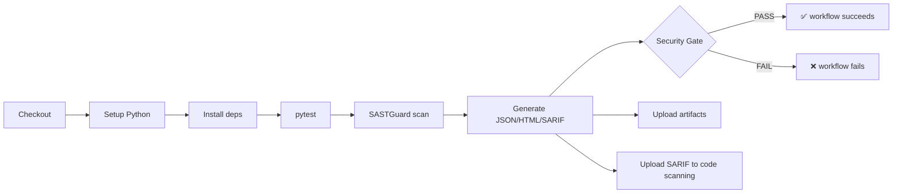
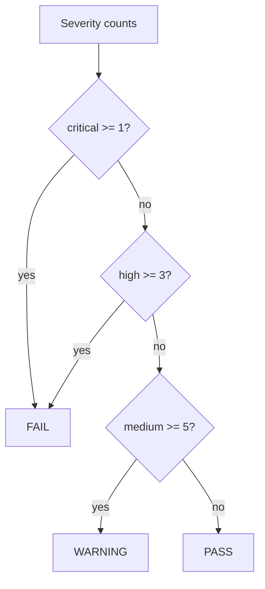

# DevSecOps

SASTGuard is designed to run inside a CI/CD pipeline and to gate merges on
security findings.

## Pipeline



Defined in `.github/workflows/security.yml`:

1. **Checkout** the repository.
2. **Setup Python** 3.11.
3. **Install** `requirements.txt` + `requirements-sast.txt` (Bandit + Semgrep).
4. **Run tests** with `pytest`.
5. **Scan** with the CLI, generating `sast-report.json/html/sarif`.
6. **Upload** the reports as workflow artifacts (always, even on gate failure).
7. **Upload SARIF** to GitHub code scanning.
8. **Enforce the gate** — a FAIL exit (1) fails the whole workflow.

## CLI

```bash
python -m app.cli scan <path> --gate \
  --json sast-report.json --html sast-report.html --sarif sast-report.sarif
```

| Flag | Purpose |
|------|---------|
| `--gate` | apply the security gate and set the exit code |
| `--json/--html/--sarif FILE` | write reports |
| `--no-bandit`, `--no-semgrep` | disable external engines |
| `--fail-critical N`, `--fail-high N`, `--warn-medium N` | override the policy |

Exit codes: **0** = PASS, **1** = Security Gate FAIL, **2** = tool error.

## Security Gate policy



Thresholds are configurable per invocation.

## Running the whole stack

```bash
docker compose up --build
```

Services: `frontend`, `backend`, `worker`, `postgres`, `redis`, `ollama` — each
with healthchecks, named volumes and a shared bridge network. Secrets come from
environment variables; `.env.example` documents them and no real credentials are
committed.

## Local tooling note

In the development machine used to build this project, Docker, Semgrep, Redis,
PostgreSQL and Ollama were **not** installed, and Node was too old to build the
frontend locally. All integrations are implemented and configured; the commands
above install and run them in a proper environment or via Docker. The native
engine, Bandit, the API, the CLI, the gate and the full test suite were executed
and verified locally inside the project virtual environment.
