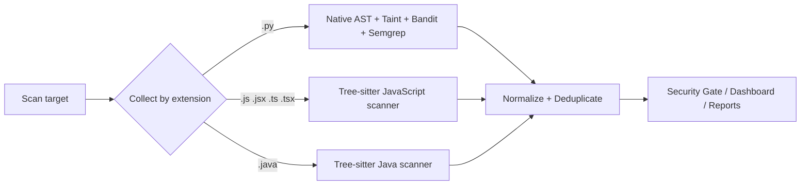

# Multi-language SAST (JavaScript, TypeScript & Java)

SASTGuard analyses **Python** with its native `ast`-based engine (unchanged —
see `SAST_ENGINE.md`) and additionally analyses **JavaScript/TypeScript** and
**Java** with dedicated scanners built on [Tree-sitter](https://tree-sitter.github.io/).
A single scan can cover a mixed-language project; every finding is normalized
into the same `Finding` model and flows through the same deduplication,
Security Gate, dashboard and reports.

## How it fits the existing engine



* **Python is untouched.** The native AST engine, Taint Analysis, Bandit and
  Semgrep run exactly as before and only ever receive `.py` files.
* **File routing by extension** happens in `sast/engine.py` (`_collect_files`),
  which shares the same skip-list as the Python collector (`node_modules`,
  build output, VCS metadata are never scanned; `*.d.ts` is skipped).
* **One Finding model.** JS/Java findings carry a new `language` field
  (`python` | `javascript` | `typescript` | `java`) and `engines=["javascript"]`
  / `["java"]`. Deduplication, severity counting and the Security Gate are
  language-agnostic, so the new findings require no downstream changes.

## Dependencies & graceful degradation

The scanners rely on two optional packages, declared in
`backend/requirements-sast.txt` and installed **only in Docker / CI** (and the
deploy environment):

```
tree-sitter==0.23.2
tree-sitter-language-pack==0.7.2   # prebuilt JS/TS/TSX/Java grammar wheels
```

`tree-sitter-language-pack` ships prebuilt grammar binaries as wheels, so no C
toolchain is needed at install time. When these packages are **not** installed,
`sast/parser/treesitter_parser.is_available()` returns `False`, each scanner's
`available()` returns `False`, and the engine simply skips JS/Java — identical
to how Bandit/Semgrep behave when their tools are missing. Python scanning is
never affected.

## Rules

Pattern-based rules on the syntax tree. Argument/assignment shapes are inspected
so that constant literals and safe APIs are distinguished from
dynamically-built, higher-risk usage, which keeps obvious false positives down.

### JavaScript / TypeScript (`sast/scanners/javascript_scanner.py`)

| Rule | Detects | Severity | CWE |
|------|---------|----------|-----|
| `SG-JS001` | `eval()` with a dynamically built argument | CRITICAL | CWE-95 |
| `SG-JS002` | `child_process.exec()` / `execSync()` command execution | CRITICAL / HIGH | CWE-78 |
| `SG-JS003` | assignment of dynamic data to `.innerHTML` / `.outerHTML` | HIGH | CWE-79 |
| `SG-JS004` | SQL built via `+` string concatenation passed to a query call | HIGH | CWE-89 |
| `SG-JS005` | hardcoded credential / secret | MEDIUM | CWE-798 |

False-positive guards: constant-literal `eval('1+1')` is not flagged; `RegExp.exec`
is excluded from the command rule; `textContent` and parameterized queries are safe;
`process.env.X` secret values are ignored.

### Java (`sast/scanners/java_scanner.py`)

| Rule | Detects | Severity | CWE |
|------|---------|----------|-----|
| `SG-JAVA001` | `Runtime.getRuntime().exec()` command execution | CRITICAL / HIGH | CWE-78 |
| `SG-JAVA002` | SQL built via `+` concatenation to JDBC `execute*`/`prepare*` | HIGH | CWE-89 |
| `SG-JAVA003` | insecure deserialization (`ObjectInputStream.readObject`) | CRITICAL | CWE-502 |
| `SG-JAVA004` | weak hash `MessageDigest.getInstance("MD5"/"SHA-1")` | MEDIUM | CWE-327 |
| `SG-JAVA005` | hardcoded credential / secret | MEDIUM | CWE-798 |

False-positive guards: `SHA-256` is not flagged; `ProcessBuilder` with an argument
list and `PreparedStatement` with bound parameters are safe; `System.getenv(...)`
secret values are ignored.

## Scope & limitations (important, by design)

* These scanners perform **deterministic pattern detection on the AST**. They are
  **not** a full interprocedural Taint Analysis for JavaScript or Java — a value
  is not tracked from an HTTP request parameter to a sink across functions,
  methods or files. Full taint tracking exists only for Python today.
* Detection is intraprocedural and shape-based: e.g. SQL injection is detected
  when a `+`-concatenated SQL-looking string is passed to a query/execute call.
  Indirect construction (building the string several statements earlier, or in
  another function) may not be caught.
* The hardcoded-secret rules use name + value heuristics; very short or
  placeholder values are intentionally ignored.
* TypeScript type-only constructs are parsed but no type-aware rules are applied.

## Uploads

`settings.allowed_extensions` now includes
`.py,.js,.jsx,.mjs,.cjs,.ts,.tsx,.java,.zip`. Single-file uploads and `.zip`
projects accept these source types; **all** existing ZIP protections are
preserved (extension allow-list, total size limit, path-traversal rejection,
Zip-Slip guard, member count and uncompressed-size/zip-bomb limits). `.d.ts`
files are skipped.

## Tests

`backend/tests/test_js_java_scanners.py` covers vulnerable detections, safe-code
negatives (false-positive guards) and a mixed Python+JS+Java project scanned
through the single `SastEngine`, asserting the Security Gate receives the
findings. The module uses `pytest.importorskip`, so it is skipped where
Tree-sitter is not installed and runs in CI/Docker where it is.

Sample code lives under `vulnerable_samples/javascript/` and
`vulnerable_samples/java/` (each with a `safe/` subfolder).
