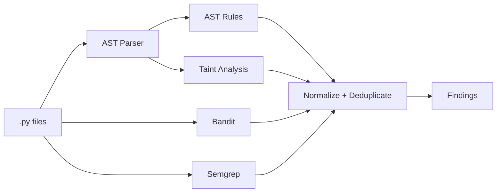
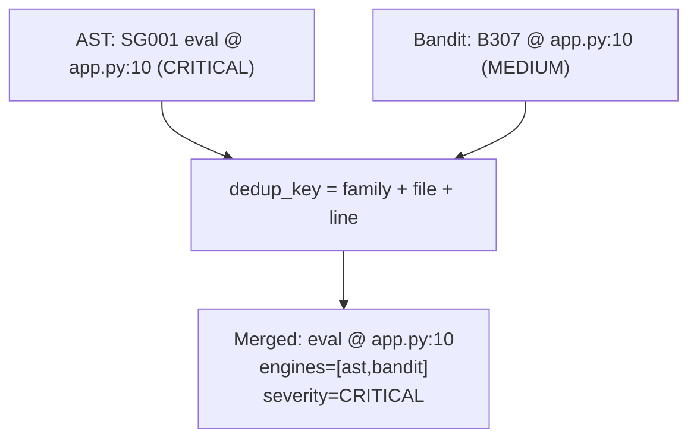

# SAST Engine

The engine analyzes Python **statically** (via the standard `ast` module) and
combines three sources of findings into one normalized, deduplicated result set.

## Pipeline



## The Finding model

Every engine maps its output to a single dataclass (`sast/models.py`):

| Field | Meaning |
|-------|---------|
| `rule_id` | engine-specific rule identifier |
| `title`, `description` | human-readable summary |
| `file_path`, `line`, `column` | location |
| `code_snippet` | the offending source line |
| `severity` | CRITICAL / HIGH / MEDIUM / LOW / INFO |
| `confidence` | 0..1 |
| `cwe`, `owasp` | taxonomy references |
| `recommendation` | how to fix |
| `engines` | which engines reported it (e.g. `["ast","bandit"]`) |
| `taint_path` | ordered SOURCE→PROPAGATION→SINK steps when applicable |

## Rules

Rules live in `sast/rules/` and self-register:

```python
@register
class EvalRule(Rule):
    rule_id = "SG001"
    title = "Use of eval()"
    def check(self, module):
        ...
        return findings
```

Adding a detection is just adding a class — the engine iterates every registered
rule. Rules operate on the **AST and syntactic context**, not blind regex. For
example, the hardcoded-password rule inspects assignment targets whose names match
a secret-like pattern and whose value is a non-placeholder string literal; the
`yaml.load` rule checks whether a `SafeLoader` is passed before flagging.

### Detections

| # | Class | Rule id | Severity | CWE |
|---|-------|---------|----------|-----|
| 1 | Hardcoded password | SG001-pw | HIGH | CWE-798 |
| 2 | Hardcoded API key/token | SECRET-KEY | CRITICAL | CWE-798 |
| 3 | `eval()` | SG001 | CRITICAL | CWE-95 |
| 4 | `exec()` | SG002 | CRITICAL | CWE-95 |
| 5 | `subprocess(shell=True)` | SG003 | HIGH | CWE-78 |
| 6 | `os.system()` | SG004 | HIGH | CWE-78 |
| 7 | SQL injection | SG007 / TAINT-SQLI | CRITICAL | CWE-89 |
| 8 | Command injection | TAINT-CMDI | CRITICAL | CWE-78 |
| 9 | Insecure `pickle` | SG009 | HIGH | CWE-502 |
| 10 | Unsafe `yaml.load` | SG010 | HIGH | CWE-502 |
| 11 | MD5 | SG011 | MEDIUM | CWE-327 |
| 12 | SHA1 | SG012 | MEDIUM | CWE-327 |
| 13 | Insecure `random` (security) | SG013 | HIGH/LOW | CWE-330 |
| 14 | `requests(verify=False)` | SG014 | MEDIUM | CWE-295 |
| 15 | Flask `debug=True` | SG015 | HIGH | CWE-489 |
| 16 | Path traversal | TAINT-PATH | HIGH | CWE-22 |

## External engines

- **Bandit** runs as a subprocess (`bandit -r -f json`) and its results are mapped
  to the `Finding` model (`sast/scanners/bandit_scanner.py`).
- **Semgrep** runs with the project's custom ruleset in `semgrep_rules/` (or the
  bundled `p/python` registry) and is likewise normalized.
- Both degrade gracefully (`shutil.which`) when not installed, so the native
  engine always works.

## Deduplication



Each rule id maps to a logical **family** (e.g. `B307`, `SG001` and the semgrep
`eval-detected` all map to `eval`). Findings with the same family + file + line
merge into one: the highest severity and confidence win, every contributing engine
is recorded, and any taint path is preserved.
