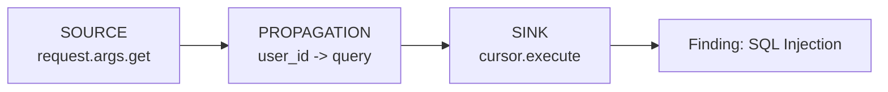
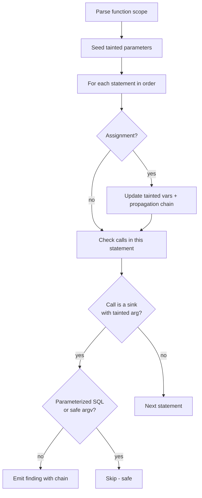

# Taint Analysis

Taint analysis tracks **untrusted data** from where it enters the program
(**sources**) through variable assignments (**propagation**) to dangerous
operations (**sinks**). When tainted data reaches a sink without passing through a
**sanitizer**, a finding is produced with the full chain.



## Worked example

```python
def handler():
    user_id = request.args.get("id")               # SOURCE
    query = "SELECT * FROM users WHERE id = " + user_id  # PROPAGATION
    cursor.execute(query)                           # SINK  -> SQL Injection
```

Reported chain:

```
SOURCE:      request.args.get("id")       (line 2)
PROPAGATION: user_id -> query             (line 3)
SINK:        cursor.execute(...)          (line 4)
```

## Sources, sinks, sanitizers

Defined in `sast/taint/config.py` and easily extended.

| Category | Examples |
|----------|----------|
| **Sources** | `input()`, `request.args`, `request.form`, `request.json`, `sys.argv`, `os.environ` |
| **SQL sink** | `cursor.execute`, `executemany`, `executescript` |
| **Command sink** | `os.system`, `subprocess.run/call/Popen`, `os.popen` |
| **Code sink** | `eval`, `exec` |
| **Path sink** | `open` |
| **Sanitizers** | `int`, `float`, `shlex.quote`, `html.escape`, `os.path.basename`, `secure_filename`, … |

## Algorithm



Key properties (`sast/taint/analyzer.py`):

- **Intraprocedural** per function scope, processing statements in order so later
  statements see taint produced earlier.
- **Sanitizer-aware**: a tainted value wrapped in a sanitizer call is treated as
  clean; the traversal does not descend into the sanitized sub-expression.
- **Parameterized queries are safe**: `cursor.execute("… %s", (value,))` with a
  constant query string and a separate parameters argument is not flagged.
- **Safe argv is safe**: `subprocess.run(["echo", name], shell=False)` passes the
  tainted value as a list element, not through a shell, so it is not flagged
  (while `os.system`/`os.popen` always use the shell and are not exempt).
- **Limited interprocedural seed**: when a user function is called with a tainted
  argument, the corresponding parameter is treated as tainted in that function.

## Safe vs unsafe

| Code | Result |
|------|--------|
| `cursor.execute("… WHERE id = " + uid)` | **SQL Injection** |
| `cursor.execute("… WHERE id = %s", (uid,))` | safe |
| `os.system("ping " + host)` | **Command Injection** |
| `subprocess.run(["ping", host])` | safe |
| `uid = int(request.args.get("id"))` then used | sanitized |
| `open(request.args.get("file"))` | **Path Traversal** |

## Limitations

Aliasing, container element tracking, full call-graph interprocedural flow and
framework-specific routing are out of scope. The analysis favors precision for the
common patterns above and keeps false positives low (verified against the
`vulnerable_samples/safe` set, which produces zero native findings).
